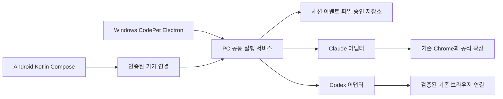

# 구조와 기술 결정

기준일: 2026-11-04 · 이 문서는 목표 구조다. 현재 구현과 구분한다.

## 1. 실행 위치와 화면

에이전트, 프로젝트 파일, 로그인, 브라우저는 PC가 소유한다.
Android는 PC의 세션에 명령을 보내고 승인·파일·결과를 받는다.
PC가 꺼졌을 때 대신 실행하는 클라우드는 초기 제품에 포함하지 않는다.

## 2. 기술 선택과 검증 상태

| 항목 | 방향 | 상태 |
|---|---|---|
| PC UI | 현재 Electron + HTML/CSS/JavaScript 유지, 필요한 부분만 분리 | 원칙 결정 |
| 공통 실행부 | 현재 Node 기반 모듈에서 서비스/어댑터 추출. 새 코드 TypeScript는 도입 비용 검토 후 선택 | 구조 방향, 상세 P1 결정 |
| Android | Kotlin + Jetpack Compose, 설치형 APK | 기본 선택, 버전/최소 OS P1 결정 |
| Codex 실행 | 공식 App Server 우선 검증; 기존 exec는 호환 경로 | P1 검증 필요 |
| Claude 실행 | 현재 CLI 양방향 연동과 공식 SDK를 비교 | 인증/과금/승인/Chrome 검증 후 결정 |
| Claude 브라우저 | 사용자가 쓰는 Chrome + 공식 확장/native messaging | 선호 확정, 실제 연동 미검증 |
| Codex 브라우저 | 현재 제공 도구의 실행 위치와 재사용 가능한 연결 확인 | 미확정, 앱 도구 자동 상속 보장 안 함 |
| 연결 프로토콜 | 파일/기기 API + 순서 있는 이벤트 스트림, 로컬 IPC와 같은 도메인 계약 | 설계 제안 |
| 외부 원격 연결 | 사설 네트워크/VPN 경로 먼저 검증 | P6 결정 |
| 종료 상태 알림 | Android 정책에 맞는 푸시/중계 설계 | P6 결정, 외부 서비스 자동 도입 안 함 |

전면 모노레포 변환을 선행 조건으로 삼지 않는다. 새 경로는 예를 들어
`src/runtime/`, `shared/protocol/`, `android/`처럼 추가할 수 있지만 P1에서
upstream 병합 비용을 비교해 확정한다. 기존 src를 한 번에 이동하지 않는다.

## 3. 공통 계약

최소 객체:

- `Session`: 대화 ID, 참가자, 작업공간, 생성/수정 시각, 데이터 버전.
- `Participant`: 공급자/계정 참조, capability, 선택 모델·추론과 다음 턴 설정.
- `Run`: 실행 ID, 세션/참가자, 실제 적용 설정, 시작/종료, 결과 상태.
- `ToolCall`: 호출 ID, 입력 요약, 상태, 결과/오류와 관련 파일.
- `Approval`: 도구 호출/실행/세션/계정 연결, 대상, 요청 권한, 만료, 결정과 결정 기기.
- `Attachment`: 파일 ID, 이름, MIME, 크기, 해시, 업로드 상태, 공급자별 전달 상태.
- `Artifact`: 파일 ID/구조화 내용, 미리보기 종류, 생성 실행, 사용 가능한 동작.
- `Event`: 고유 ID, 세션 내 순번, 발생 시각, 종류, payload, 계약 버전.

최소 이벤트는 메시지 추가/델타, 도구 시작/완료/실패, 승인 요청/결정/만료,
파일 업로드/결과 등록, 설정 적용, 실행 중단/완료/오류, 연결 상태를 포함한다.
추론 내용은 공급자가 실제로 제공하고 표시 가능한 범위만 렌더링한다.
보이지 않는 내부 추론을 생성해서 표시하지 않는다.

새 클라이언트는 마지막 이벤트 커서를 보내 누락분을 받고, 오래된 커서에는
스냅샷 재동기화가 가능해야 한다. 요청 ID와 승인 ID를 재사용해 중복 실행을 막는다.
PC와 모바일 어느 한쪽의 승인 결과가 확정되면 다른 화면도 같은 결정을 표시한다.

## 4. 권한과 승인

파일 읽기/쓰기, 셸 명령, WebSearch/WebFetch, MCP 도구, 브라우저 사이트 접근을
각각 정책으로 표현한다. UI 표시만이 아니라 가능한 backend 경계에서 강제한다.
OS sandbox, CLI tool allowlist, 제품 내부 정책이 제공하는 보장 수준을 구분한다.

- 기본은 필요한 작업만 허용하고 추가 작업은 승인한다.
- 일회 승인과 세션/작업공간 규칙을 분리한다. 명령과 사이트의 실제 범위를 표시한다.
- 거부/만료/취소는 해당 호출에 반영한다. 전체 작업을 무조건 다시 실행하지 않는다.
- 오류 문장만 보고 이미 실행된 도구를 다시 실행하지 않는다.
- 개인 전역 CLI 설정은 기본 수정 대상이 아니다. 설정 출처와 적용 우선순위를 진단한다.
- 브라우저 연결은 에이전트별로 켜고 선택한 Chrome/프로필/사이트 상태를 표시한다.

## 5. 세션·모델·계정

모델·추론은 실행 설정으로 취급하고 대화 정체성과 분리한다.
현재 모델/추론이 scope에 포함된 구조는 기존 cursor를 보존하는 마이그레이션이 필요하다.
계정·작업공간·보안 경계 변경은 단순 모델 변경과 별도 정책으로 다룬다.

- 변경 기본값: 현재 실행은 유지, 다음 턴부터 새 설정 적용.
- 중단 후 재실행은 별도 동작이다. 이미 발생한 파일/웹 부작용을 자동 취소했다고 표현하지 않는다.
- 모델 목록/추론 단계는 실제 공급자에서 조회하고 계정별로 분리한다.
- 원래 CLI의 대화 writer와 CodePet이 같은 기록을 동시에 수정하지 않도록 기존 격리를 보존한다.
- 기존 구독/로그인 경로를 유지할 수 있는지 확인한다. API 키나 별도 비용이 필요한 기능은 선택 사항으로 표시한다.

## 6. 파일·이미지·GUI

PC는 파일 ID와 세션 권한으로 파일을 제공한다. Android에 PC의 절대 경로를
전달하는 방식으로 다운로드를 구현하지 않는다. MIME/해시/크기/이름을 검증하고
업로드 초안·완료·실패·취소를 구분한다. 원본 첨부와 변환 결과의 관계도 보관한다.

이미지 렌더링, 이미지 이해, 이미지 생성/편집은 별도 capability다.
문서 생성은 파일 처리 도구가 있어야 하고, 문서 미리보기는 변환기/뷰어 범위 안에서 제공한다.
모든 공급자에게 모든 파일이 전달됐다고 표시하지 않는다.

결과 종류는 텍스트/코드, 이미지, 다운로드 파일, PDF/문서/시트, HTML/차트로 시작한다.
실행형 결과는 격리된 iframe/WebView/별도 origin을 사용하고, Node/Electron API·임의
파일·외부 네트워크 접근을 기본 차단한다. 필요한 외부 동작은 검증된 메시지로 요청한다.
HTML이나 SVG를 받았다는 이유로 앱 권한으로 스크립트를 실행하지 않는다.

## 7. Android 연결과 알림

초기 연결은 명시적 기기 페어링, 만료/폐기, 암호화된 전송을 사용한다.
공급자 자격 증명은 PC에 두고 기기 연결 토큰과 분리한다.
사진 선택기/파일 선택기/공유 인텐트를 사용하고 URI 접근 권한의 수명과 업로드 재시도를 처리한다.

앱 포그라운드의 이벤트 스트림과 백그라운드/종료 상태의 알림은 다른 경로다.
푸시/중계가 필요하면 서비스·운영 비용·알림 payload 범위를 결정한다.
PC 오프라인에서는 기존 기록 열람/초안 작성과 실행 대기를 구분하고 몰래 재전송하지 않는다.

## 8. 원본 업데이트와 배포

- `main`: 원본 추적. `develop`: 개조판 통합/계획. 기능 PR은 develop 대상.
- upstream 반영은 merge 전용 브랜치에서 테스트한 뒤 develop에 PR로 통합한다.
- 개조판 전용 release 태그/워크플로는 원본 main/v* 트리거와 분리해서 설계한다.
- 현재 업데이트 조회 URL뿐 아니라 다운로드 허용 prefix/체크섬/버전·배포 자산 검증도 함께 수정해야 한다.
- 제품 ID·데이터 폴더 변경 시 기존 데이터 발견/백업/이전/복구 흐름을 먼저 검증한다.
- 초기 릴리스는 Windows + Android 우선. 원본 macOS/Linux 지원 상태는 별도 표시한다.

## 9. 참고 문서

확인일: 2026-11-04. 구현 시 설치 버전과 최신 문서의 차이를 다시 확인한다.

- [Codex App Server](https://learn.chatgpt.com/docs/app-server): 세션·실행 이벤트·승인을 연결하는 후보.
- [Codex MCP](https://learn.chatgpt.com/docs/extend/mcp): 재사용 가능한 설정과 앱 실행 환경을 구분할 때 참고.
- [Claude Code CLI](https://code.claude.com/docs/en/cli-reference): 실행·세션·모델·추론 옵션.
- [Claude Agent SDK](https://code.claude.com/docs/en/agent-sdk/overview): SDK 선택 검토 자료. 인증/과금 호환성 검증을 생략하지 않는다.
- [Claude in Chrome](https://code.claude.com/docs/en/chrome): 기존 Chrome 연동·전제 조건·사이트 권한.
- [Android Compose](https://developer.android.com/compose): Android UI 기본 선택.
- [Android Photo Picker](https://developer.android.com/training/data-storage/shared/photo-picker): 선택한 미디어 첨부.
- [Android 공유 데이터 수신](https://developer.android.com/develop/ui/compose/sharing/receive): 다른 앱의 사진/파일 받기.
- [Fork 동기화](https://docs.github.com/en/pull-requests/how-tos/work-with-forks/syncing-a-fork): 원본 변경 병합.
